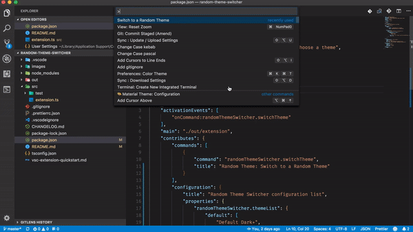

# Random Theme Switcher

A simple extension that picks and applies a **random** theme from a list you control.



## Features

Themes are drawn from `randomThemeSwitcher.themeList`. If that list is empty, all installed
themes are used instead. The currently active theme is never picked again. If the newly selected
theme is in `randomThemeSwitcher.preventReloadThemeList`, the automatic switch on the next startup
is skipped (those themes reload the window when applied).

### Switch modes

| Mode       | Description                                                                                      |
| ---------- | ------------------------------------------------------------------------------------------------ |
| `manual`   | No automatic switch, only the `Random Theme: Switch to a Random Theme` command changes the theme |
| `startup`  | Switches once every time VS Code starts                                                          |
| `daily`    | Switches once per local calendar day                                                             |
| `interval` | Switches every `randomThemeSwitcher.switchInterval` minutes                                      |
| `typing`   | Switches on each keypress, debounced by 750 ms                                                   |

> **Warning:** `typing` mode changes the theme while you type and is disruptive. It is intended for
> demonstrations and experiments, not for everyday use.

Settings are applied live: there is no need to reload VS Code after changing them.

### Commands

- `Random Theme: Switch to a Random Theme` (`randomThemeSwitcher.switchTheme`, keybinding
  `Ctrl+K Ctrl+Shift+T` / `Cmd+K Cmd+Shift+T`) — apply a random theme right away.
- `Random Theme: Copy all installed themes in settings` (`randomThemeSwitcher.copyInstalledThemes`) —
  write every installed theme into `randomThemeSwitcher.themeList`. You can narrow the themes by
  side (both / light / dark) and optionally filter them with an exclude regular expression.
- `Random Theme: Add current theme to settings` (`randomThemeSwitcher.addCurrentTheme`) — append the
  active theme to the list.
- `Random Theme: Remove current theme from settings` (`randomThemeSwitcher.removeCurrentTheme`) —
  drop the active theme from the list.

## Requirements

- VS Code 1.95.0 or newer.
- No other extensions are required; themes are discovered from the installed theme extensions.

## Extension Settings

- `randomThemeSwitcher.switchMode`: `manual` | `startup` | `daily` | `interval` | `typing`.
  Default `startup`.
- `randomThemeSwitcher.switchInterval`: number of minutes between switches in `interval` mode.
  Default `15`, minimum `3`, maximum `1440`.
- `randomThemeSwitcher.themeList`: `string[]` of theme names to pick from. Default `[]`, which means
  "all installed themes".
- `randomThemeSwitcher.preventReloadThemeList`: `string[]` of theme names that must not be replaced
  immediately after being applied (they reload the window). Defaults to the Material Theme suite.

Example:

```json
{
  "randomThemeSwitcher.switchMode": "startup",
  "randomThemeSwitcher.themeList": [
    "Andromeda Italic",
    "Cobalt2",
    "Dracula",
    "Tomorrow Night Blue",
    "Ayu Dark",
    "One Monokai",
    "Night Owl"
  ]
}
```

> **Tip:** use `Random Theme: Copy all installed themes in settings` to fill the list quickly.

## Development

```bash
npm install
npm run compile
```

- Press `F5` to launch an Extension Development Host with the extension loaded.
- `npm test` runs the unit tests.
- `npm run lint` runs ESLint.

## Known Issues

- `typing` mode switches the theme on every keypress (debounced) and can feel jarring.
- Themes that reload the window on activation interrupt the switch cycle; list them in
  `randomThemeSwitcher.preventReloadThemeList` to avoid an immediate follow-up switch.
- The extension only manages themes contributed by installed extensions; it cannot add themes.

## Release Notes

See [CHANGELOG.md](CHANGELOG.md).
